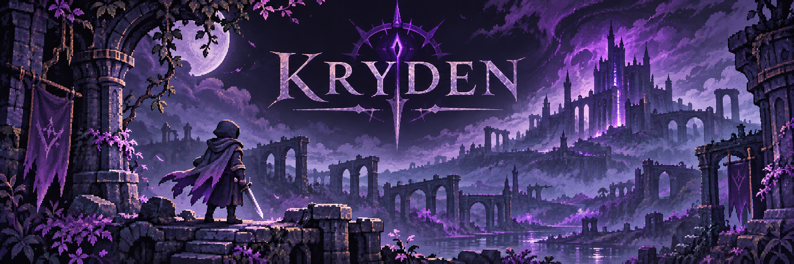
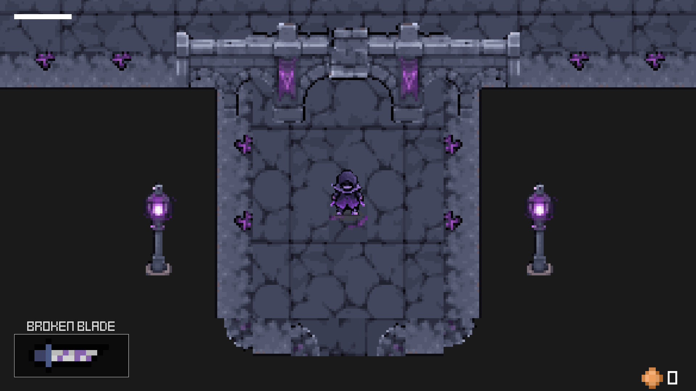
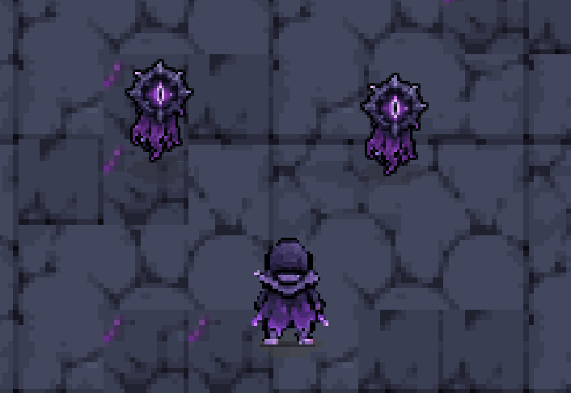
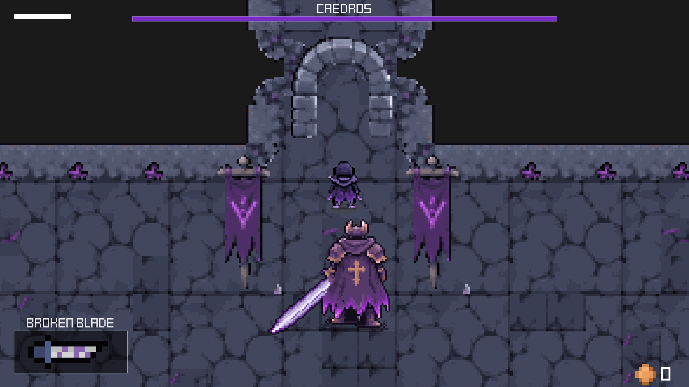

<p align="center">
  
</p>

<h1 align="center">KRYDEN</h1>

<p align="center"><em>A Dark Fantasy Action-Adventure</em></p>

<p align="center"><strong>Kryden v0 Alpha</strong></p>

<p align="center">
  
  
</p>

---

## About Kryden

Eldravain was once a prosperous kingdom. Then came the **Veilfall**.

A mysterious corruption known as **the Veil** has consumed much of the land, twisting those who remain and trapping many in an unnatural cycle of suffering.

You are **Kaelen**, an amnesiac swordsman who awakens in an ancient underground passage called **the Ashen Vein**. With only a broken blade and fragments of memory, Kaelen sets out through a fallen kingdom to uncover the truth behind its destruction.

## Gameplay

<p align="center">
  
</p>

Kryden is a top-down action-adventure built around **deliberate, timing-based swordplay**, where positioning and understanding enemy behavior matter. Explore in real time, fight with your sword, dodge out of danger, face enemies and bosses, and piece together what happened from the world around you.

The long-term vision is a larger, interconnected world. That world is planned for future development and is not part of the current release.

### Current Release Scope

Kryden v0 Alpha is a short playable introduction consisting of three maps, all located within the Ashen Vein.

| Area        | Description                                                 |
| ----------- | ----------------------------------------------------------- |
| Spawn Cave  | Kaelen awakens and encounters introductory dialogue pop-ups |
| Combat Cave | Basic combat against Bats and Veilseers                     |
| Boss Cave   | Tutorial boss encounter against Caedros                     |

The current combat system consists of:

- Basic sword attacks.
- Dodge rolling.

## Enemies and Bosses

<p align="center">
  
</p>

Little that still moves in Eldravain means you well. Two kinds of creature wait in the dark of the Ashen Vein:

**Bats** — Creatures inhabiting the underground passages.

**Veilseers** — Supernatural enemies associated with the Veil.

<p align="center">
  
</p>

### Caedros, the Oathbound

An ancient guardian of the Ashen Vein, infused with a fragment of Veylor's power.

Caedros serves as the tutorial boss and final encounter of the current release.

## Getting Started

### Prerequisites

- [Git](https://git-scm.com/)
- [LÖVE2D](https://love2d.org/)

Nothing else is required. The libraries Kryden uses are included in the repository.

### Clone the Repository

```bash
git clone https://github.com/RunilDaptardar/Kryden.git
cd Kryden
```

### Run Kryden

From the `Kryden` folder, the one containing `main.lua`, run:

```bash
love .
```

| Platform | How to run                                                                                                                                                                      |
| -------- | ------------------------------------------------------------------------------------------------------------------------------------------------------------------------------- |
| Windows  | Run `love .` if `love` is on your `PATH`. Otherwise, drag the `Kryden` folder onto `love.exe`, or run `"C:\Program Files\LOVE\love.exe" .` (the default install location).     |
| macOS    | Install LÖVE into `Applications`, then run `/Applications/love.app/Contents/MacOS/love .`, or drag the `Kryden` folder onto the LÖVE app.                                       |
| Linux    | Install LÖVE using your distribution's package manager or the installers on the LÖVE website, then run `love .`.                                                                |

Kryden starts in fullscreen. Press **Backspace** to switch to a window.

### Controls

| Action              | Input                                 |
| ------------------- | ------------------------------------- |
| Move                | `W` `A` `S` `D` or Arrow Keys         |
| Sword attack        | Left Click or `J` (aims at the cursor) |
| Dodge roll          | `Space` (while moving)                |
| Pause               | `Esc` or `Enter`                      |
| Inventory           | `Tab` or `I`                          |
| Fullscreen          | `Backspace`                           |
| Advance dialogue    | `Space`, `Enter`, `E`, or `J`         |
| Skip dialogue       | `Esc`                                 |
| Navigate menus      | `W` / `S`, Arrow Keys, or Mouse       |
| Confirm menu option | `Enter`, `Space`, `E`, or Left Click  |

## Development

Kryden is actively developed. The current Alpha establishes the game's foundations and introduces players to its world.

Future development will expand:

- Combat mechanics and player abilities.
- Enemies and bosses.
- Exploration and world design.
- Storytelling and NPC interactions.
- Visual effects and animation.
- Audio and atmosphere.

### Acknowledgments

Kryden is built upon [legend-of-lua](https://github.com/challacade/legend-of-lua), an open-source LÖVE2D project created by [challacade](https://github.com/challacade).

The original project provided the foundation for Kryden's early development, which is being expanded and reworked into a dark-fantasy action-adventure.
